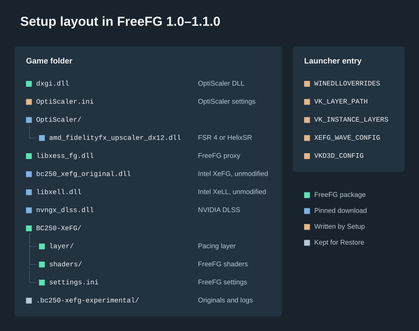
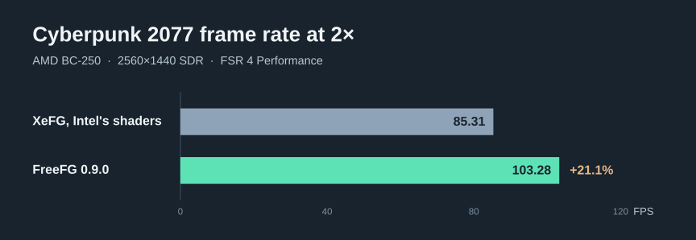

<!-- Copy of packaging/public/README.md for this folder of the repository, written by release/export_tree.py --public with its links adjusted; edit packaging/public/README.md instead. -->
# FreeFG

FreeFG makes Intel XeSS Frame Generation (XeFG) faster on the AMD BC-250, in DirectX 12 games under Proton on Linux.

- Intel's runtime, downloaded unmodified, generates the frames. A proxy `libxess_fg.dll` runs part of its GPU work with
  this project's own shaders, which are faster on the BC-250 and gave the same pixels where compared.
- A Vulkan layer paces the output for VRR displays. Upscaling runs through OptiScaler, with a BC-250 build of AMD FSR 4
  or with HelixSR.
- On GPUs other than Intel's, the runtime generates 2× (Intel's documented limit); FreeFG does not raise that limit.
  With MFG Unlocker, a separate tool that does, FreeFG's shaders also run at 3× and 4×.
- It does not modify Intel's DLL, replace the graphics driver or run on Windows.

How it works: [ARCHITECTURE.md](packaging/public/ARCHITECTURE.md).

FreeFG is an independent project. It is not affiliated with, endorsed by, sponsored by or supported by Intel, AMD,
NVIDIA, ASRock, Valve or the OptiScaler project. Intel, XeSS and Xe are trademarks of Intel Corporation. AMD, FidelityFX
and FSR are trademarks of Advanced Micro Devices, Inc. NVIDIA and DLSS are trademarks of NVIDIA Corporation. Steam is a
trademark of Valve Corporation. Other names are trademarks of their owners. All are used only to identify what FreeFG
works with.

## Requirements

| Item | Needed |
| --- | --- |
| Hardware | AMD BC-250 (ASRock board, Cyan Skillfish APU, PCI ID `1002:13fe`); [other GPUs](packaging/public/TROUBLESHOOTING.md#other-gpus) |
| System | a Linux distribution with Steam; GE-Proton 11-6 or 11-7 (others untested); a larger GTT helps at 1440p and 4K |
| Graphics driver | Mesa RADV, any current version. The BC-250's compute queue (off in stock Mesa) is optional and needs a kernel with the matching BC-250 fixes. |
| Compositor | gamescope 3.16.28 or newer, as in Steam Game Mode; realtime priority helps ([Extras](#extras)) |
| Setup | Python 3.11 or newer, Zenity (desktop Setup), `bsdtar` (libarchive); network access for the first installation ([PRIVACY.md](packaging/public/PRIVACY.md)) |
| Games | 64-bit DirectX 12 under Proton, from Steam, Heroic or Lutris; an ASCII-only folder path; no anti-cheat ([COMPATIBILITY.md](packaging/public/COMPATIBILITY.md)) |

Setup's **Check system** reports each item and warns about a compute-queue Mesa on a kernel without the fixes. Tested
configuration: [MEASUREMENTS.md](packaging/public/MEASUREMENTS.md#test-system). The Steam Deck is untested.

## Install

### Setup

1. Extract the release archive and run `Start-freefg.sh` in Desktop Mode to open Setup.
2. **Add games**: each game's rendering `.exe` (for Unreal Engine games often in `Binaries/Win64`, not the root folder's
   launcher).
3. **Install**: choose the frame-generation input and the [upscaler](#upscaler-fsr-4-or-helixsr). **Automatic per game**
   (recommended) takes the recipe's input, else native XeSS FG where the game ships it, else OptiFG, and shows each
   game's verdict and any steps for you. Install games that need different explicit inputs separately.
4. In the game, select the upscaler that runs FSR 4 (it may be called DLSS, FSR or XeSS) and set frame generation:

| Input | In the game |
| --- | --- |
| DLSS FG | DLSS frame generation on (Streamline 2 or newer). |
| FSR 3.1 FG, FSR 3.0 FG | FSR frame generation on. The HUD is interpolated with the scene, so fast HUD elements can smear slightly. |
| OptiFG | The usual upscaler, the game's frame generation off. OptiFG derives its inputs from upscaling and can affect HUDs. |
| Native XeSS FG | XeSS frame generation on; its runtime DLL must be beside the `.exe`. |

The first start, also with a new frame-generation mode, can pause while shaders compile.

### Command line

```sh
python3 install.py check GAME.exe       # compatibility verdict; changes nothing
python3 install.py preview GAME.exe     # downloads, then shows what would change
python3 install.py install GAME.exe     # Automatic input, FSR 4
python3 install.py configure GAME.exe --upscaler helixsr   # or fsr4
python3 install.py status GAME.exe
python3 install.py restore GAME.exe
python3 install.py helixsr              # download HelixSR
python3 install.py doctor               # Check system
```

`install` also takes `--fg-input` (`dlssg`, `upscaler`, `fsrfg`, `fsrfg30`), `--route native` (the game's own XeSS FG),
`--upscaler helixsr` and `--dlss-helper no` or `yes` ([NOTICE.md](NOTICE.md#nvidias-terms)). A game's existing
OptiScaler must be the 10.0.0-pre1 nightly of 4 or 29 September 2026 (restore or update any other first); a custom DLL
path in `OptiScaler.ini`, symlinked game files or another proxy DLL need manual integration.

## Upscaler: FSR 4 or HelixSR

FSR 4 (the BC-250 build, RC11) is the default. [HelixSR](https://github.com/lonewolf0622/HelixSR) by lonewolf0622
runs NVIDIA's DLSS upscaling network without an NVIDIA GPU; FreeFG ships none of it
([NOTICE.md](NOTICE.md#helixsr)). Frame generation stays XeFG. To use it:

1. Choose **HelixSR (by lonewolf0622)** in Setup (in Install, or **Upscaler** for installed games). Setup offers to
   download its official 2.0.0 release if it is not on your computer ([PRIVACY.md](packaging/public/PRIVACY.md#helixsr-optional)).
2. Build it once in a terminal with its own setup:
   `cd ~/.cache/bc250-xefg-testers/helixsr/HelixSR-2.0.0 && ./helixsr-setup.sh --no-fg` (upscaler only). At its first
   game question press **Ctrl+C**, or answer **n** for each game; it changes no game before its last question. Enter
   would install HelixSR its own way, replacing FreeFG's OptiScaler with HelixSR Scaler.
3. Choose HelixSR in Setup again. In the game, choose the upscaler as for FSR 4.

For games FreeFG installed, use Restore, not HelixSR's uninstaller.

## 3× and 4× with MFG Unlocker

[MFG Unlocker](https://github.com/dashdogy/MFG-Unlocker) by dashdogy is a separate OptiScaler plugin that lifts Intel's
limit on GPUs other than Intel's, up to 6×. FreeFG does not ship it, link it into its own code or change it; support
for it comes from its authors ([NOTICE.md](NOTICE.md#mfg-unlocker-not-shipped)). With it, FreeFG's shaders run on the
work that is still Intel's, on OptiScaler's frame generation ([how](packaging/public/ARCHITECTURE.md#another-mod-on-intels-runtime),
[checks](packaging/public/MEASUREMENTS.md#checks-of-100)).

1. Install FreeFG for the game, check 2×, and close the game.
2. Download `MFGUnlocker-v1.6.0.zip` from its Releases page and check it against its `SHA256SUMS.txt`.
3. Rename `MFGUnlocker.dll` to `MFGUnlocker.asi` and put it in the `OptiScaler/plugins/` folder beside the `.exe`. Do
   not give it a DLL name such as `dxgi.dll`; those are OptiScaler's.
4. In `OptiScaler.ini`, set `LoadAsiPlugins=true` under `[Plugins]` (Setup sets it only in setups it creates) and
   `FGOutput=xefg` under `[FrameGen]`. Optionally set `XeFGModel=default` under `[XeFG]` (table below).
5. In the game, set the frame count in OptiScaler's menu (**Insert**, **Frame Generation**), which saves it. OptiScaler's
   frame limit counts output frames: at 4×, 117 FPS is about 29 real frames per second.
6. To return to 2×, remove `MFGUnlocker.asi` and set 2×. Leave `LoadAsiPlugins` on: it also loads OptiPatcher, which
   some games need for their upscaler inputs.

| `[XeFG] XeFGModel` | Network | FreeFG's shaders run on |
| --- | --- | --- |
| `default` | Intel's 2× model at every frame count. MFG Unlocker's authors found that it places the outer generated frames at the wrong times at 6×, which smears them; 3× and 4× are unchecked. | the whole network |
| not set (MFG Unlocker's default) | MFG Unlocker's own model, which replaces five of the network's programs | the rest of the network |

- With a game's own XeSS frame generation, FreeFG accelerates nothing while MFG Unlocker is loaded
  ([details](packaging/public/ARCHITECTURE.md#optiscalers-contexts-only)).
- Before Restore, delete `OptiScaler/plugins/MFGUnlocker.asi` and the `RTXMFG-*` files beside the `.exe` (keep a copy of
  `RTXMFG-Universal.json` for its settings). Otherwise Restore leaves them and their folder, and says so.
- A new Install sets 2×; add MFG Unlocker and `XeFGModel` again afterwards.

## Game compatibility

Before it writes anything, Setup gives every game a verdict, with the way forward for a refused one
([COMPATIBILITY.md](packaging/public/COMPATIBILITY.md)):

- 19 games have a verified recipe from the BC-250.
- 758 games have an entry from the OptiScaler wiki. Its inputs, launch options and compatibility-list verdict guide the
  automatic setup; other advice is shown with its condition.
- Any other 64-bit DirectX 12 game with an upscaler or frame-generation input gets an automatic setup from detection.

## In the game

- Frame generation on or off: the game's settings, or OptiScaler's menu (**Insert**, **Frame Generation**, **Active**).
- XeFG does not interpolate in exclusive fullscreen. The installer keeps OptiScaler inputs borderless; with native XeSS
  FG, choose borderless or windowed.
- If the real frame rate times the frame count exceeds the refresh rate, the game's frame rate drops to match, adding
  latency without smoothness.
- Generated frames make motion smoother, not the game more responsive; pacing holds each frame a few milliseconds.
- In Game Mode, set Steam's screensaver timeout to **Never** or install the [extra](#extras); the screensaver runs
  behind games and shows as bursts of VRR flicker ([details](packaging/public/TROUBLESHOOTING.md#problems)).

## What Setup changes

Setup downloads the pinned files in [PRIVACY.md](packaging/public/PRIVACY.md#what-the-installer-downloads) from their publishers, checked
by SHA-256, into `~/.cache/bc250-xefg-testers`. It saves each game file it replaces in the backup folder, then places
the files in the figure beside the game's rendering `.exe` and writes the launch settings
([variables](packaging/public/ARCHITECTURE.md#the-installer)) and a recipe's settings
([COMPATIBILITY.md](packaging/public/COMPATIBILITY.md#supported-games)); existing launch options and wrappers stay. An OptiScaler already
in the game keeps its file name. OptiScaler's support files come only with a fresh setup, `nvngx_dlss.dll` only for a
DLSS input without a game copy. Setup waits until the game, and for launcher settings the launcher, is closed.



Recorded in a live install of 0.9.0 (Echo Point Nova, Steam, OptiFG input, 19 October 2026); 1.0.0 adds five shaders.

## Restore and uninstall

Restore puts back every file Setup replaced, removes what it added and its launch settings, and undoes recipe changes to
game settings key by key. It keeps launch options and settings you changed, and names any file that changed after
installation, such as a DLL a game update replaced; the original stays in the backup folder `.bc250-xefg-experimental`
(renamed `-restored-…`; it also holds FreeFG's logs). Restore before you change a game's input, hand its files to
another installer, or install another build.

To uninstall, restore every game, run each installed extra's `uninstall.sh`, and delete the extracted folder, the cache
`~/.cache/bc250-xefg-testers` (with any HelixSR downloaded there) and, once unneeded, the
`.bc250-xefg-experimental-restored-…` folders. HelixSR's own setup keeps its downloads in `~/.local/share/HelixSR`.

## Extras

Optional helpers in `extras/`, each with a README and `uninstall.sh`
([SECURITY.md](packaging/public/SECURITY.md#what-runs-on-your-computer)): `gamescope-cap-sys-nice` gives gamescope realtime priority
(`CAP_SYS_NICE`), which most distributions other than SteamOS leave out; without it, its composition and page flips
queue behind the game's GPU work (uneven VRR refresh). `steam-screensaver-in-game` sets Steam's screensaver timeout to
Never while a game runs, then restores yours.

## Status

1.0.0, 20 October 2026. Tested only on the AMD BC-250 under Proton in Steam Game Mode, with a short qualification:
checks without a GPU, then one short start per question on one BC-250 ([checks](packaging/public/MEASUREMENTS.md#checks-of-100)).
Everything else is untested. The 2×-only pre-release 0.9.0, with the same shaders at 2×, had the longer qualification
in [MEASUREMENTS.md](packaging/public/MEASUREMENTS.md).



Headless; the two arms ran a day apart, bridged by a reference build. HDR10 and TV figures:
[MEASUREMENTS.md](packaging/public/MEASUREMENTS.md#frame-rate-cyberpunk-2077).

## Known limitations

- 2× on its own; 3× and 4× only with MFG Unlocker. No generated-frame scaling.
- This build has run in main menus and benchmarks, not in gameplay. Flatpak Steam and Heroic are not qualified.
- Frame pacing works only under gamescope.
- Only a game process's first XeFG context is accelerated.
- FreeFG closes the game when the runtime does something it does not recognise, for example after an update to
  Intel's runtime pin ([details](packaging/public/ARCHITECTURE.md#stepping-aside)).
- HelixSR has had one start with FreeFG; Restore, image and frame rate with it are not checked.

## Troubleshooting

[TROUBLESHOOTING.md](packaging/public/TROUBLESHOOTING.md): the logs, common problems, environment variables and other GPUs.

## Credits and licences

FreeFG's own code is under the MIT licence; every other component keeps its own ([NOTICE.md](NOTICE.md)). Intel's
XeFG runtime is used under Intel's licence, which applies to you as its user; while it runs, FreeFG changes how part
of its GPU work is carried out ([NOTICE.md](NOTICE.md#intels-terms),
[ARCHITECTURE.md](packaging/public/ARCHITECTURE.md#what-is-changed-at-run-time)). [OptiScaler](https://github.com/optiscaler/OptiScaler)
is by its contributors; FreeFG ships a modified GPL-3.0 build ([source](NOTICE.md#optiscaler-source)). HelixSR is by
lonewolf0622; MFG Unlocker, not shipped, is by dashdogy. NOTICE.md credits the FSR 4 build's origins and the OptiScaler
wiki. Security reports and rights holders' concerns: [SECURITY.md](packaging/public/SECURITY.md).

## Documents

[COMPATIBILITY.md](packaging/public/COMPATIBILITY.md) · [TROUBLESHOOTING.md](packaging/public/TROUBLESHOOTING.md) · [ARCHITECTURE.md](packaging/public/ARCHITECTURE.md) ·
[MEASUREMENTS.md](packaging/public/MEASUREMENTS.md) · [PRIVACY.md](packaging/public/PRIVACY.md) · [NOTICE.md](NOTICE.md) · [BUILDING.md](packaging/public/BUILDING.md) ·
[CHANGELOG.md](packaging/public/CHANGELOG.md) · [CONTRIBUTING.md](packaging/public/CONTRIBUTING.md) · [SECURITY.md](packaging/public/SECURITY.md)
