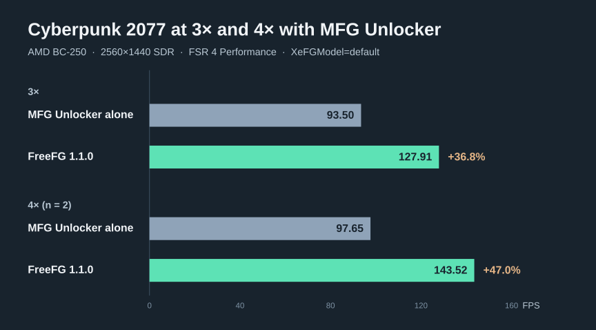
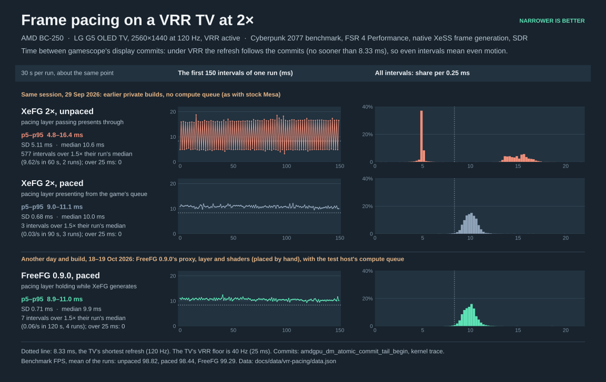
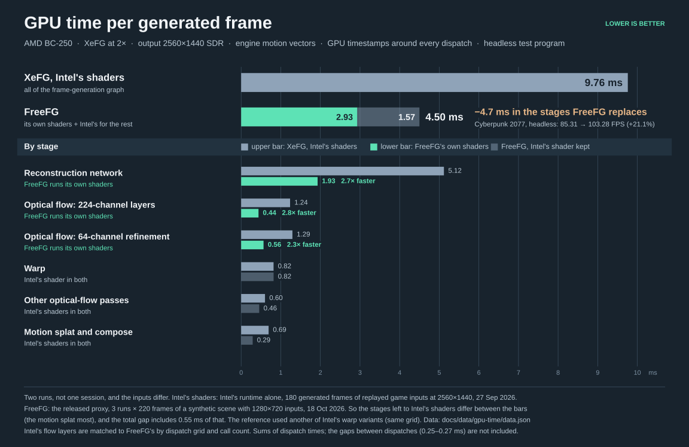

# Measurements

The numbers describe FreeFG on this hardware; they are not a prediction for other games, settings, displays or GPUs.

## Cyberpunk 2.5 with HelixSR

26 October 2026. FreeFG 1.1.3.1, full GOG Cyberpunk 2077 `2.5_RedModFix` (build `60152385347545148`),
Phantom Liberty installed. High graphics, ray tracing off, 80-degree field of view, HelixSR 2.0.0 Quality:
1706×960 input and 2560×1440 output. The game labels this Custom after the upscaler selection; advanced graphics
settings remain High. These conditions differ from the older FSR 4 measurements below.


| Range | Mode | Game FPS | Output FPS | Output FPS, 95% CI | Added ms / generated frame |
| --- | --- | ---: | ---: | --- | ---: |
| SDR | No FG | 71.95 | 71.95 | 71.58–72.32 | — |
| SDR | Intel XeFG 2× | 43.17 | 86.34 | 86.09–86.59 | 9.27 |
| SDR | FreeFG 2× | 54.18 | 108.36 | 108.00–108.73 | 4.56 |
| SDR | Intel XeFG 3×<sup>(unofficial)</sup> | 31.30 | 93.89 | 93.82–93.96 | 9.03 |
| SDR | FreeFG 3×<sup>(unofficial)</sup> | 43.89 | 131.67 | 130.62–132.72 | 4.44 |
| SDR | Intel XeFG 4×<sup>(unofficial)</sup> | 24.49 | 97.95 | 97.63–98.26 | 8.98 |
| SDR | FreeFG 4×<sup>(unofficial)</sup> | 37.77 | 151.06 | 150.77–151.35 | 4.19 |
| HDR10 | No FG | 71.64 | 71.64 | 71.46–71.81 | — |
| HDR10 | Intel XeFG 2× | 42.46 | 84.92 | 84.74–85.09 | 9.59 |
| HDR10 | FreeFG 2× | 53.26 | 106.52 | 106.24–106.80 | 4.82 |
| HDR10 | Intel XeFG 3×<sup>(unofficial)</sup> | 30.57 | 91.72 | 91.53–91.92 | 9.37 |
| HDR10 | FreeFG 3×<sup>(unofficial)</sup> | 43.20 | 129.61 | 129.32–129.90 | 4.59 |
| HDR10 | Intel XeFG 4×<sup>(unofficial)</sup> | 23.84 | 95.36 | 95.29–95.43 | 9.33 |
| HDR10 | FreeFG 4×<sup>(unofficial)</sup> | 36.53 | 146.12 | 145.83–146.41 | 4.47 |

Compared with Intel's shaders at the same factor, FreeFG increases output FPS by
25.5% / 40.2% / 54.2% at 2× / 3× / 4× in SDR and
25.4% / 41.3% / 53.2% in HDR10. Game FPS falls as more frames are generated.
**(unofficial)** marks 3×/4×: Intel's runtime requires separately supplied MFG Unlocker 1.6.0 on this GPU,
with `XeFGModel=default`. It is present in both the Intel and FreeFG higher-factor conditions, absent at 2×.

### Derived frame cost

For output factor `m`, let `G_m` be mean game-rendered FPS with FG and `G_0` the no-FG mean in the same dynamic range:

```text
Added ms per game frame       = 1000 / G_m − 1000 / G_0
Added ms per generated frame  = (1000 / G_m − 1000 / G_0) / (m − 1)
```

At 2× there is one generated frame per game frame, so the two costs are equal. At 3× and 4×, divide by two and three.
For example, FreeFG 2× HDR10 gives
`(1000 / 53.2622) − (1000 / 71.6363) ≈ 4.82 ms` per generated frame. All published costs use unrounded means.
This is a throughput-derived estimate of added frame time, including interactions with other rendering work;
it is not isolated GPU execution time or input latency. The JSON also supplies total cost per game frame and the
four paired-block cost estimates. Chart whiskers describe FPS uncertainty; no cost confidence interval is plotted.

### Method

Each of the 14 conditions has one full unscored warm-up and four measured starts: **70 completed starts, 56 scored**.
All passed the technical checks. The four 14-condition blocks balance average run position and reverse pair order.
Whiskers and table intervals are Student-t 95% confidence intervals across four run means (three degrees of freedom).
They describe repeatability on this machine. No run was discarded for its frame rate. Preparation pilots are unscored;
one interrupted pilot lost its parent harness and was retained separately, then repeated successfully before this series.

All FG conditions use OptiScaler's DLSS FG input → XeFG, with the same proxy, layer, HelixSR and game settings.
The Intel control sets `BC250_XEFG_DISABLE=1` and uses an empty wave table, disabling FreeFG's shader replacements
and wave overrides. No FG disables generation in both the game and OptiScaler. Every condition uses
`[InitFlags] DisableReactiveMask=true`, the Cyberpunk/HelixSR workaround described below. It removes an auxiliary
temporal-reconstruction input; image-quality equivalence to mask-on is not claimed.

Game FPS is the benchmark's per-game-frame CSV row count divided by elapsed benchmark time. Output FPS comes from
the summary; its output-frame count divided by the CSV row count matches the requested factor in every run.
OptiScaler/HelixSR logs confirm sustained 1706×960 input; the game's DLSS-route summary reports the 2560×1440 output.
FG logs verify factors 2/3/4; FreeFG runs report all 13 accelerated programs and seven FP16 pipelines without fallback
in the OptiScaler context. The game's additional native XeSS context is left unaccelerated beside MFG Unlocker.
Intel controls report no acceleration.

Headless gamescope runs at 240 Hz. VSync, game/XeLL/OptiScaler frame caps and FreeFG's output/frame-start pacing are
off throughout. Reflex is enabled, XeLL's cap is zero and native Anti-Lag 2 is disabled. Condition-specific Mesa and
vkd3d caches start empty, are filled by a warm-up, then remain warm for the four measurements.
The test uses the installed MastaG Mesa `3:26.2.5-1.331`, GE-Proton11-11 and existing BC-250 driver flags;
`RADV_DIRECTMESH=1` is fixed throughout. The loaded driver and all 57 RADV environment entries match the preceding
2× campaign. No screenshots or GPU readback run during timing. These are throughput measurements, with no new
display-pacing, image-quality or end-to-end latency claim.

[Run means, intervals, costs, hashes and driver settings](../../docs/data/cyberpunk-helixsr/data.json) ·
[Figure script](../../docs/data/cyberpunk-helixsr/plot.py) ·
[Compact chart](../../docs/assets/cyberpunk-helixsr-fps-narrow.svg).

The [25 October 2× dataset](../../docs/data/cyberpunk-helixsr/2x-2026-10-25.json) is preserved separately:
six warm-ups and 24 scored starts, with FreeFG/Intel output gains of 25.4% SDR and 25.3% HDR10.
None of those earlier runs is mixed into this 26 October comparison.

## Checks of 1.1.3.1

25 October 2026. One profile entry changes: `graph-prepare224.dxil` (`835dc58bffaad6d9`) uses wave64 instead of
wave32. The shader bytes are identical. The rebuilt proxy is
`f52f24ec6df082a1784638746da867b1fe557c9c0a20d487820213cfb2e06805`; the wave table is
`076fc0f41dd87e26b695b0384d5f46476d218e2c5e1703159ab7a75f9bcb078e`. The other 141 wave choices and the presentation
layer remain 1.1.3's. This setting applies wherever the shader is created, without an executable-name check.
The replacement 1.1.3.1 also updates OptiScaler and the Cyberpunk 2.5 recipe, described below.

A wave-table bisection in Cyberpunk 2077 2.5 associated early GPU faults with this module's wave32 selection. Keeping the complete table and changing only that entry to 64 completed full SDR and HDR10 benchmarks:
HelixSR 2.0.0 Quality, High preset, 2560×1440 output, GE-Proton 11-11, Mesa 26.2.5, BC-250. Those diagnostic runs used
an earlier October 25 OptiScaler candidate and a DLSSG-to-XeFG recipe. Their frame rates are diagnostic and are
excluded from the scored performance comparison.

The rebuilt proxy passed nine same-day native 2× SDK comparisons against 1.1.3: 144 generated images were
byte-identical. Cases cover 1920×1080, 2560×1440 and 3840×2160; SDR and HDR10; normalized and pixel motion; the
default forms and Exact mode. Both arms used the shipped presentation layer. The 1080p and 4K cases include 320
observed calls to the affected 48-column transform in the hotfix runs. No fault, failed program replacement or
fallback was reported. This is an output comparison, not a timing result.

The replacement package's OptiScaler (`b3602882…`) and hotfix payload passed Echo Point Nova menu starts at 2×, 3×
and 4× with HelixSR and MFG Unlocker 1.6.0.
Each start reported the requested SDK factor, all 13 accelerated programs and seven FP16 pipelines, with no fallback
or GPU fault, and exited normally. The original files and settings were then restored byte-for-byte. These are
compatibility checks; the menu runs do not establish display pacing or gameplay performance.

The exact underlying cause is unresolved. This input-transform shader has no wave operations in its shipped form,
and each thread owns its scratch addresses. The change does not alter its arithmetic. The earlier TV pacing checks below remain the evidence for the unchanged
presentation layer. The new headless comparison measures throughput; no end-to-end latency or new TV pacing claim
is made.

The bundled OptiScaler DLL is `b3602882c7e194af523e50861a222d63c0c56b013cff4bfb5b187ca4f6666656`, built from
fork `03db4f8692878e65748769ebe583c053cae96360` (source tag `bc250-03db4f8`). It includes the actual October 25 nightly
source `08e13adf`, including the FPS-overlay merge omitted from the nightly's change list. The fork retains separate
XeSS/XeFG/XeLL paths, automatic settings saving and FreeFG's adaptive frame-start pacing. Its 27 path read/save/reload
combinations pass. The public installer passed an upgrade/Restore on a copy of the full Cyberpunk install, restoring
files, settings and Heroic configuration exactly, then installed the candidate in the full game.

Cyberpunk's updated recipe uses DLSS upscaling input and DLSS FG input to XeFG, keeps the game's own XeSS library,
and enables Reflex with native Anti-Lag 2 disabled. The user's obsolete controls/settings were migrated separately
through the updated game; Setup does not perform a general settings-schema conversion.

The Cyberpunk/HelixSR recipe also disables the auxiliary reactive/bias mask input. Before the new scored series,
mask-off passed ten diagnostic starts (three short and seven full); a mask-on reversal faulted on its first start,
then mask-off passed again. Three full no-FG runs passed on the installed driver, including SDR and HDR. The
same fault reproduced without FreeFG code. These are compatibility diagnostics, excluded from frame-rate means.
Removing the mask changes an upscaler input; equivalent temporal image quality is not claimed.

## Checks of 1.1.3

Release checks, 25 October 2026. The shader profile, Intel runtime and upscalers are 1.1.2's. The changes are
library-path handling and pacing; these checks do not add an image-quality claim.

Candidate binaries (sha256):

- Proxy: `a3d9f72fee97a789f1f9f822f293bcfc1563eed9302c991bfa084e47eff47623`.
- Presentation layer: `5de86d968c8adbfb42cf3d56bd020a0ba82e92ca31e9dcf4e319cbc479963687`.
- OptiScaler: `1e8025628911495a35d40764bef69157a3d80ce0c3b67b19b2cf7e090ea1dc20`, source `be42012aff2dbe26e5565d076e50f227e428cad1`, tag `bc250-be42012`.

CONTROL Resonant, the saved outdoor rooftop, AMD BC-250, GE-Proton 11-11, HelixSR 2.0.0, physical 2560×1440 120 Hz
HDR/VRR TV under gamescope 3.16.30. Output intervals come from DRM flip events; game starts from XeLL markers.
Each sample is 25–45 seconds with one second omitted at each end. A long interval is greater than 1.5 times that
sample's median. No image readback runs during the timing samples. Later samples let the hardware-breakpoint
attachment settle for eight seconds before timing. Camera pans are separate from stationary samples.

| Check | Before | Candidate |
| --- | --- | --- |
| 3× game starts, 1706×960 input, VSync off, uncapped; 5th–95th percentile | 16.2–34.7 ms | 24.0–26.9 ms |
| Same 3× scene, adjacent interval pairs with `abs(a-b)/(a+b) > 0.2` | 89.5% | 0% |
| Same 3× scene, frames displayed per second | 117.94 | 118.10 |
| 4× stationary, 2560×1440 input through HelixSR, VSync off, uncapped; 99th-percentile display interval | 16.4 ms | 11.3 ms |
| Same 4× scene, long flips | 69 in 33 s | 0 in 38 s |
| Same 4× scene, frames displayed per second | 97.28 | 97.54 |
| 2× saved settings, 1706×960 input; frames displayed per second | 96.77 | 96.91 |
| Same 2× scene, long flips | 0 in 28 s | 0 in 33 s |

The frame-start cause was also isolated by switching `BC250_XELL_PACE` off and on in the **same early candidate DLL**:
89.5% uneven pairs became 0%, at 117.94 versus 117.64 displayed FPS. The later candidate adds immediate reset after a
large stall. The output-layer changes were checked separately at 4×, where XeLL was already giving regular game starts.

Continuous camera motion at 3×, after five seconds of motion to let its onset settle, showed 114.07 displayed FPS,
a 10.3 ms 99th-percentile interval and one long flip in 33 seconds. The final build's game starts were 24.0–26.9 ms
at the 5th–95th percentiles in the stationary sample. Starting the scripted pan caused an 80–200 ms transient in
separate samples; its source in the game/capture path was not isolated, and this release does not claim to fix it.
The 2×/4× rows preceded the final large-hitch reset in the frame-start controller; the presentation binaries are the
same, and the final controller was checked at 3× and in the stall-burst simulation.

Motion is not hitch-free. At 4× with the normal 1706×960 input and the saved 115.8 FPS cap, a 33-second camera-pan
sample showed 115.42 FPS, a 10.5 ms 99th-percentile interval and 9 long flips. At native input, a camera pan showed
91.77 FPS, a 13.8 ms 99th-percentile interval and 7 long flips. CPU/game stalls still reach the screen. A controlled
90 ms process pause remains visible, but extra swapchain capacity removes the earlier several-second throughput
slowdown after it. At uncapped 4× with the normal input size the game produces about 131 FPS, above this TV's 120 Hz
ceiling; that is not a valid all-frames-shown VRR condition. Keep the output below the display's maximum.

The larger MFG allowance buffers frames only when timing misses require it and decays afterwards. Its latency cost
varies with the scene and stalls; end-to-end input latency was not measured. Two extra 1440p HDR swapchain images
were available compared with the old layer (six instead of four), within the surface's reported limit. HelixSR stayed
active throughout; its own frame generation stayed disabled.

The path fix has a 27-case read/save/reload regression using OptiScaler's real config fragments. The preceding path-fix
candidate also passed an Echo Point Nova HelixSR/2× start. CPU checks cover frame-start bunching and stall recovery,
presentation jitter and swapchain limits, concurrent presents, and the proxy's loader/bookkeeping under Wine. The
native-route game check was incomplete at the 1.1.3 release: the then-existing Cyberpunk benchmark exited with both
the released build and the path-fix build, under either upscaler. The newer Cyberpunk comparison above uses OptiScaler's
DLSS FG route. These pacing results cover CONTROL Resonant, not library-wide gameplay,
SDR, other GPUs, or a different compositor.

## Scope

All results come from one AMD BC-250. They do not predict performance on other GPUs, games or settings.

- The current baseline is [Cyberpunk 2.5 with HelixSR](#cyberpunk-25-with-helixsr). Older sections use the game version,
  upscaler and release named there; do not compare them as a single time series.
- Headless output FPS counts generated frames but does not measure a physical display, VRR quality or input latency.
  TV sections use display-commit timing and state their limits separately.
- `n` counts starts. `SD` describes variation between runs; `SE` is uncertainty in the stated comparison. The current
  chart instead shows Student-t 95% confidence intervals. Small samples and single starts are identified.
- Earlier protocols sometimes used an outlier rule or excluded contaminated runs. Each section preserves those rules
  and exclusions; none is silently replaced by the current protocol.
- Figure data and scripts live in `docs/data/`. The SDK scenes and benchmark harnesses are separate research tooling;
  the public tree reproduces builds and CPU checks, not these GPU measurements.

## Builds

| Component | Version | SHA-256 |
| --- | --- | --- |
| `libxess_fg.dll` | 0.9.0 | `3bb43859ccff3a98786dd3c931e430523dbd05676f8d721515973ea73f935410` |
| `libxess_fg.dll` | 1.0.0 and 1.0.1 | `77f2625174fb88c149a3f76e6c4ae829382d620b256e4a3213a64eca56ea42a7` |
| `libxess_fg.dll` | 1.1.0 and 1.1.1 | `830be46e9c515b63dfe637f5b601eba7e81676b2d51f01a6aebfdf66bcdf186a` |
| `libxess_fg.dll` | 1.1.2 | `b0b71d6575ad8c27072741545459364a880ccb6f0f369a23de58558f02505ec3` |
| `libxess_fg.dll` | 1.1.3 | `a3d9f72fee97a789f1f9f822f293bcfc1563eed9302c991bfa084e47eff47623` |
| `libxess_fg.dll` | 1.1.3.1 | `f52f24ec6df082a1784638746da867b1fe557c9c0a20d487820213cfb2e06805` |
| Pacing layer `libxefg_wave.so` | 1.1.3 / 1.1.3.1 | `5de86d968c8adbfb42cf3d56bd020a0ba82e92ca31e9dcf4e319cbc479963687` |
| `OptiScaler.dll` | replacement 1.1.3.1 | `b3602882c7e194af523e50861a222d63c0c56b013cff4bfb5b187ca4f6666656` |
| HelixSR DLL, locally built | 2.0.0 in the current comparison | `33647875141293ebae0df8b79a18902a953b4f2b18fe5fe6980d73e1c4879ec7` |
| Shader profile, digest of its files | 1.1.0 and 1.1.1: 49 files, 130 `waves.txt` entries | `a35efb131305708d4fa7b719bd3d2472952f540a52dc52cf755548710004cdbf` |
| Shader profile, digest of its files | 1.1.2: 61 files, 142 `waves.txt` entries | `2058acb6ce0965900cceaa1bd477560724b5afd8ea675a369815182aa909ae0a` |
| Pacing layer `libxefg_wave.so` | 0.9.0 to 1.1.2 | `d5f9800d0f52903f16b5a71af42599d89640bc41fc0bfc4dad66248f30ac3271` |
| `OptiScaler.dll` | 0.9.0 | `244eca5c0927dff802d7f2a506afe9e7776bcdc489bdc3acdf56e9c92f7b437d` |
| `OptiScaler.dll` | 1.0.0 to 1.1.2 | `5e570dff6299866c508b60634d0dcfc5a53975840888f2aa5e69ba31c3819da6` |
| Installer `install.py` | 1.1.1 | `1d1844c0252d1e782fd6dedae49074962438b1910780c86bbc97a3849eb4c6f6` |
| Installer `install.py` | 1.1.2 | `5833344047bd3678c49b9f8f7e60a1ef28d7a132c224aff66280a76580093b49` |
| Installer `launcher_config.py` (the launch settings) | 1.1.1 and 1.1.2 | `094667194ea353ea247d52a540395af39d80b00892c6bea5c695f4d2921c0c0d` |
| Intel's XeFG runtime, unmodified | 1.3.1.78 | `ec5e0c65e075570c6ede72618bb666d0be0c2e10b2ea9762c0fe8cb8e375ab27` |
| FSR 4 DLL, BC-250 build RC11 (`4.1.1r11`) | installed by 0.9.0 to 1.1.1 | `8192ea97620f8e6407bff346bf905f0d555ff73d89fe14616eb1fa5e41ab3175` |
| FSR 4 DLL, BC-250 build RC12 (`4.1.1r12`) | installed since 1.1.2 | `4b0df27761d7ced52c30dcbd1641c55bdcf4d2ae10d59f7e5b4b2f895b6bba79` |
| MFG Unlocker `MFGUnlocker.dll`, not shipped | 1.6.0 | `161b9e1245a3736dc462ee83f4ad51e6125d8e7e73ce3eedde89d2eed60c69fa` |

The shader profile's digest is the SHA-256 of its files' sorted `<file name><TAB><SHA-256>` lines, one per line.
1.1.1's copy of this table gave `8701a132…` for `install.py`: the file of its [live install](#live-install-and-restore),
before the fix to Status and Check named there. 1.1.1 shipped the file above.

## Test system

| Campaign | Configuration |
| --- | --- |
| Current Cyberpunk 2.5 / HelixSR, 25–26 October | BC-250, GPU governor capped at 1850 MHz; CachyOS, kernel `7.3.0-2.326-cachyos-bc250`, Mesa/RADV `3:26.2.5-1.331`, GE-Proton11-11, gamescope 3.16.30. Headless 2560×1440 at 240 Hz. Exact driver flags and hashes are in the chart data. |
| CONTROL Resonant pacing, 25 October | BC-250, GE-Proton11-11, HelixSR 2.0.0, gamescope 3.16.30; physical LG G5 at 2560×1440, 120 Hz, HDR/VRR. |
| 1.1.2 checks, 23–24 October | Kernel 7.3.0, Mesa 26.2.5 BC-250 build; GE-Proton11-11 for the release comparisons/live start, 11-7 for earlier test builds. FSR 4 RC12 for the release; earlier candidates used RC11. |
| Earlier campaigns | Kernel 7.2.8, Mesa 26.2.2 BC-250 build with compute queue, GE-Proton11-7, gamescope 3.16.28. GPU limit 1850 MHz; 6 GiB GTT. |
| Earlier headless output | 1440p/120 Hz for native 2×, 240 Hz for 3×/4× and 4K. No VRR. |
| Earlier TV output | LG G5, 1440p/120 Hz HDR/VRR through a DP-to-HDMI adapter; measurements used a 40 Hz VRR floor. |

The older FSR 4 results use RC11 through 1.1.1. RC12's own comparisons found unchanged images and 1440p Performance
GPU time versus RC11 ([RC12 evidence](https://github.com/daniel-h-0/bc250-fsr4-fork/releases/tag/v4.0.0-rc12)); that does
not make different game versions, upscaler modes or campaign conditions interchangeable.

## Checks of 1.1.2

1.1.2 changes the U-Net and refinement kernels ([ARCHITECTURE.md](ARCHITECTURE.md#fp16-forms-approximate-output-by-default))
and installs FSR 4 RC12. Each new kernel is byte-identical to one that a test build ran first. An earlier 1.1.2 candidate
(proxy `f9f8c020`) had the same kernels plus four more FP16 forms, which it ran by default; 1.1.2 turns those four
off and drops their files. The release's proxy had its own checks. All ran on the [test system](#test-system) with
kernel `linux-cachyos-bc250` 7.3.0 and Mesa 26.2.5 RADV (a BC-250 build), 2026-10-23 and 2026-10-24.

**Output.** With the default FP16 forms, generated images differ from Intel's; the tests below quantify the numerical
differences but do not establish perceptual equivalence. With the exact switch (`BC250_XEFG_EXACT=1`), generated
images were identical to Intel's in every comparison reported below.

| Check | Build | Result |
| --- | --- | --- |
| Build | 1.1.2 | Reproducible byte for byte on the pinned toolchain ([BUILDING.md](BUILDING.md#the-pinned-toolchain)); the 52 shaders rebuild byte for byte with the pinned compiler. |
| Static check | 1.1.2 | Passes with no allowance ([NOTICE.md](NOTICE.md#the-shader-profile)). |
| Installer | 1.1.2 | Unit tests pass. The package's `settings.ini` gains `F4Q2=1` and `Exact=0`, so Setup keeps a user's values; Status and Check gain the `Output:` line; Status names the FSR 4 build. |
| Wine loader check, no GPU | 1.1.2 | As for 1.1.0, plus 1.1.2's cases: the FP16 forms on by default (seven shaders) with F4Q3; off by the launch option and by `settings.ini`; the launch option over the file; off whenever F4Q is off and in the diagnostic; their fallbacks (a missing file, a failed pipeline); F4Q2 on and off; layouts without some layers; the diagnostic at F4Q2's and F4Q3's layers; the coefficient segments against an independent product. |
| Model owner, no GPU | 1.1.2 | The coefficient buffers of every model size, three weight statistics, 16 switch settings: byte-identical to the test builds' (the default's FP16 forms, exact switch, F4Q2 off, the diagnostic) and to 1.1.1's (F4Q off). |
| Kernels, no GPU | 1.1.2 | All 17 new or changed kernels compile byte-identical to the test builds' kernels. |
| Software rasteriser, no GPU | test builds | F4Q2's, F4Q3's and the exact changes' kernels gave the exact outputs on test inputs; the FP16 forms gave the outputs of their FP16 arithmetic (the rasteriser rounds their multiply-adds unfused). 1.1.2's kernels and coefficient buffers equal the test builds' byte for byte (rows above), so these results hold for it unchanged; not re-run. |
| SDK GPU time, 2560×1440 2× engine motion vectors, scene 3, 3 runs per arm and row | test builds | ms per generated frame, SDR / HDR10, Mesa's shader cache warm: F4Q2 against 1.1.1 0.097 / 0.142–0.146 (−2.3% / −2.5 to −2.6%, 2026-10-23 morning; 4 configurations); F4Q3 and the exact changes against F4Q2 0.117 / 0.169 (−2.8%); the FP16 forms against that 0.125 / 0.185 (−3.2% / −2.9%) (both 2026-10-23 evening, one run series). The HDR10 rows ran at 1,220–1,490 MHz, below game clocks, so they overstate the saving in a game. |
| Synthetic scenes (SDK), 20 configurations | test build, exact | 704 of 704 generated images identical to Intel's shaders' with F4Q2, F4Q3 and the exact changes. |
| Synthetic scenes (SDK), 19 configurations | test build, default | Against Intel's: 0.12–16.2% of pixels differ; error against the scenes' analytic truth 0.985–1.007× Intel's. No quality gate has passed these images ([ARCHITECTURE.md](ARCHITECTURE.md#fp16-forms-approximate-output-by-default)). |
| Cyberpunk 2077, the diagnostic (`BC250_XEFG_F4Q_SHADOW=1`), headless | test builds | F4Q2: 162,992 comparisons at F4Q's and F4Q2's six points; F4Q3 and the exact decoder: 241,376 comparisons at eight points, 30,172 at each row layer; native 2× and 3× with MFG Unlocker (`XeFGModel=default`), SDR; none differing. |
| Synthetic scenes (SDK), 19 configurations, GE-Proton 11-11 | 1.1.2 default | 640 of 640 generated images identical to the test build's above (rendered with GE-Proton 11-7), so the comparisons with Intel's above hold for this release; the seven FP16 forms and the four other F(4×4) kernels ran, no F(2×2) or 1D U-Net kernel. |
| Synthetic scenes (SDK), 20 configurations, GE-Proton 11-11 | 1.1.2 exact (`Exact=1` in `settings.ini`) | 704 of 704 generated images identical to Intel's shaders'; the seven F(4×4) kernels ran, no FP16 form. With `F4Q=0`: 80 of 80 on 2 configurations identical to Intel's shaders'. |
| Cyberpunk 2077, the diagnostic, headless | earlier candidate | Native 2× and 3× with MFG Unlocker (`XeFGModel=default`), SDR, one benchmark start each: 70,320 comparisons at the eight points (8,790 at each), none differing. The diagnostic turns the FP16 forms off in both builds, so it ran this release's F(4×4) kernels and diagnostic. |
| Cyberpunk 2077, the switches, headless | earlier candidate | One native 2× SDR start each: `BC250_XEFG_EXACT=1` turned the FP16 forms off and ran the seven F(4×4) kernels; `BC250_XEFG_F4Q2=0` turned F4Q2 off. At 3× and 4× (MFG Unlocker v1.6.0, `XeFGModel=default`, 240 Hz, pacing layer off) its default, with this release's seven FP16 kernels and four more, ran accelerated with no fallback; the runtime reported 3 and 4 frames per present. Not repeated with this release. |

**Frame rate, 1.1.2 against 1.1.1** (2026-10-24; settings as in [Frame rate](#frame-rate-cyberpunk-2077), native
2×, GE-Proton 11-11 and FSR 4 RC12 in both arms; n = 6 per arm, mirrored order, one discarded warm-up start per arm and
condition; output FPS, mean ± SD; difference ± SE):

| Condition | 1.1.1 | 1.1.2 (default) | Difference |
| --- | --- | --- | --- |
| 2× SDR | 104.05 ± 0.10 | 105.75 ± 0.17 | +1.64% ± 0.08 |
| 2× HDR10 | 102.65 ± 0.15 | 104.19 ± 0.22 | +1.50% ± 0.11 |

Both arms used 1.1.1's launch settings and wave choices. New per-condition caches were warmed once per build;
vkd3d caches were separate, Mesa's shared. Mesa still grew through SDR run nine (4.7% more files) and HDR10 run seven
(2.6%). Savings per generated frame were 0.31 ms SDR and 0.29 ms HDR10. All samples were within 0.3%/0.5% of their
arm's median. An interrupted earlier HDR10 block yielded +1.72% ± 0.15 across seven measured runs; it is not pooled.

All final samples reported 2.000 presents per game frame, no `FAIL`/GPU error, the expected kernels and wave choices,
and no fallback. Pacing held every measured present: 5th–95th percentile release spreads were 1.83–1.95/1.84–1.94 ms
with 1.1.1 and 1.84–1.91/1.80–1.93 ms with 1.1.2 (SDR/HDR10).

The default's 19 synthetic configurations did not pass the image-quality gate overall. Gate version 1.2 classified
seven as pass, ten for review and two as fail; the revised version 1.4 classified 18 as pass and one panning-temporal
case as fail. Three additional held-out cases passed. These results do not establish game-image equivalence to Intel.

Not covered: the frame rate with the exact switch (`BC250_XEFG_EXACT=1`); the FP16 forms compared with Intel's in a
game (only on synthetic SDK scenes and by eye on crops); 1.1.2's default at 3× and 4× (the earlier candidate's ran
there, with four more FP16 forms), its frame rate there, and HDR10 at 3×/4×; F4Q2 and F4Q3 compared in a game in HDR10, at
4×, in other games, or without the diagnostic; the SDK timing at 3×/4× or 4K; the shader caches of an upgrade from 1.1.1;
the Setup window and a game started from Heroic itself; a live install in Steam with this release's package; a VRR
display; gameplay.

## Checks of 1.1.0

1.1.0's qualification on the [test system](#test-system), 2026-10-20 to 21.

| Check | Result |
| --- | --- |
| Build | Reproducible byte for byte from source on the pinned toolchain, also from the public source export ([BUILDING.md](BUILDING.md)); the 40 shaders rebuild byte for byte with the pinned compiler. |
| Static check | Passes with no allowance ([NOTICE.md](NOTICE.md#the-shader-profile)). |
| Installer | Unit tests pass. The installer is 1.0.1's; the package's `settings.ini` gains `F4Q=1`, so Setup keeps a user's `F4Q=0`. |
| Wine loader check, no GPU | As for 1.0.0, plus ten F4Q cases: on by default, off by the launch option and by `settings.ini`, the launch option over the file, fallback to F(2×2) when a pipeline cannot be created, a network layout F4Q does not know, the diagnostic. |
| Software rasteriser, no GPU | F4Q's kernels and the F(2×2) kernels gave byte-identical outputs on the test inputs. |
| Synthetic scenes (SDK), 20 configurations | 2560×1440 SDR and HDR10 with engine and pixel motion vectors and 3840×2160 SDR, four scenes each: 704 of 704 generated images identical to the images Intel's shaders give, with F4Q on and with it off (`F4Q=0` in `settings.ini`). With F4Q on, both its kernels ran; off, neither. |
| Cyberpunk 2077, F4Q's diagnostic (`BC250_XEFG_F4Q_SHADOW=1`), headless | 7 benchmark runs: 4 at native 2× and 3 at 3× with MFG Unlocker (`XeFGModel=default`), SDR. 96,480 comparisons of the two layers' outputs (14,784 at each of three points at 2×, 17,376 at 3×), none differing, none skipped. |
| Cyberpunk 2077, frame-rate block, headless | 54 of 54 starts valid; F4Q on in every 1.1.0 run, with both kernels ([below](#frame-rate-cyberpunk-2077)). |
| Cyberpunk 2077, F4Q's off switch, headless | One benchmark start at native 2× with F4Q at its default and one with `BC250_XEFG_F4Q=0`, which the test harness set in the game's environment (not through a Steam or Heroic launch option). With the variable, the fast log reported F4Q off by it (`F4Q_CONFIG mode=off source=BC250_XEFG_F4Q`) and F4Q created neither of its pipelines; without it, F4Q was on with both. Both runs accelerated, 2.0 frames shown per game frame, no `FAIL` line. |

Not covered: F4Q compared in a game in HDR10, at 4×, in other games, or without the diagnostic (in a game the default
path was run, not compared); a live install with Setup; a VRR display; MFG Unlocker's own model (benchmarked only at
[4K](#4k)); games without a recipe; gameplay.

## Shader caches

Mesa caches compiled pipelines; vkd3d-proton caches the information used to recreate them. Their state determines
whether the layer can apply `waves.txt` choices ([implementation](ARCHITECTURE.md#wave-sizes-bc-250-only)).

| Release | vkd3d-proton's cache | `waves.txt` lines for Intel's shaders |
| --- | --- | --- |
| 1.0.x, 1.1.0 | the game's default, with shader module identifiers | apply only where Mesa's cache does not already hold that pipeline compiled without the line |
| 1.1.1 onward | a folder of the installation's own, with shader code (Setup's two launch settings) | apply on every start |

**1.1.0, 20–21 October 2026:** all 54 frame-rate starts used caches warmed by 1.0.x and test builds. None applied the
five new Intel-shader wave choices; existing choices and the new own-shader choices applied. One empty-cache native
2× start applied its three relevant new choices, took 39 seconds longer and wrote 18.8 MB. It has no scored FPS result.

**1.1.1, 21 October:** the harness applied new launch settings to 1.1.0's binaries. Mesa's cache started warm from
1.0.x; vkd3d caches were new per route and block. Six untimed starts applied every relevant wave choice, including
each route's first compilation. Both untimed controls with 1.1.0 settings applied none. The subsequent timed block
found the new pipelines in Mesa's cache: all 14 starts with 1.1.1 settings applied the choices; none of 14 controls did.

| Condition | n | 1.1.0's settings | 1.1.1's settings | Difference |
| --- | --- | --- | --- | --- |
| 2× SDR | 4 | 104.28 ± 0.08 | 104.66 ± 0.18 | +0.36% ± 0.09 |
| 2× HDR10 | 4 | 102.50 ± 0.13 | 103.15 ± 0.12 | +0.64% ± 0.09 |
| 3× SDR, MFG Unlocker, `XeFGModel=default` | 3 | 127.87 ± 0.07 | 128.61 ± 0.08 | +0.58% ± 0.05 |

Output FPS, mean ± SD; differences ± SE. One discarded warm-up per arm and condition, except the 1.1.0-settings 3×
warm-up exited early and was not replaced. Mesa's cache was shared and warm. The control used its warm identifier
cache; the new arm filled a separate vkd3d folder through earlier starts on that route (1–4 before SDR samples, 6–9
before HDR10, 1–3 before 3×). HDR10 reused the native route's SDR cache.

The first starts with the new settings took 2–4 seconds longer where compared; later starts were within one second
of controls. Cache size grew from 35.5–36.2 to 36.0–36.7 MB. The very first upgrade start on a machine that had run
1.0.x was not timed. The empty-folder SDR warm-up reached 104.52 FPS, with a longest frame of 33.1 ms.

[Live installation](#live-install-and-restore) applied all three relevant wave choices in three measured starts.
Echo's cache grew from 15.1 to 16.7 MB; Cyberpunk's held 35.5 MB. Caches created by XeFG without any prior FreeFG
installation were not tested; the new-folder policy is expected to handle them but that is an inference.

## Checks of 1.0.0

1.0.0's proof-of-life qualification ([Status](README.md#status)) on the [test system](#test-system).

| Check | Result |
| --- | --- |
| Build | Reproducible byte for byte from source on the pinned toolchain ([BUILDING.md](BUILDING.md)). |
| Static check | Passes with no allowance ([NOTICE.md](NOTICE.md#the-shader-profile)). |
| Installer | Unit tests pass; an offline install and Restore return a throwaway game folder to its original files. |
| Wine loader check, no GPU | Loads and forwards to Intel's runtime; refuses a missing or altered runtime. With a stand-in module hooking eight of Intel's entry points, each call reaches it once with the caller it would see without FreeFG; only OptiScaler's contexts are accelerated (also a unit test). |
| Synthetic scenes, 2× | Generated images bit-identical to 0.9.0's (which match Intel's shaders where compared, [below](#generated-images-bit-identical)) in SDR 1440p, HDR10 1440p with pixel motion vectors and SDR 4K, five images each. Coefficient buffers verified; 2 frames per present. |
| Echo Point Nova (Steam, OptiScaler's frame generation) | 2×: accelerated, 2 frames per present. MFG Unlocker v1.6.0 with `XeFGModel=default`: 4× at 4 and 3× at 3 frames per present on FreeFG's shaders; one of two 3× starts ended during start-up with no error in any log, and the next start worked ([later starts](#start-up-exits-at-3)). MFG Unlocker's own model: 3× at 3, accelerated. HelixSR 2.0.0: its network ran, 2× accelerated at 2; OptiScaler's FSR 4 settings left its DLL alone; switching back to FSR 4 worked. |
| Cyberpunk 2077 (GOG through Heroic, the game's own XeSS FG), headless | Benchmark accelerated, 2.0 presents per game frame, 102.08 FPS: one run, not compared on the same day (0.9.0: 103.28 FPS on 16 October). A later same-day comparison found no measurable difference ([below](#100-against-090-at-2-same-day)). |
| Restore | Both game folders exactly as they were. |
| CONTROL Resonant (DLSS FG input), this release's OptiScaler | 32 of 32 starts reached the game; 2 presents per game frame in the 12 starts measured. |

Echo Point Nova was installed by this build's installer; its OptiScaler DLL was then replaced by hand with the one the
1.0.0 package ships.

Speed and further 3× and 4× checks: the two sections below.

Not covered: 3× and 4× on a VRR display and in their picture; changing the frame count in OptiScaler's menu while a game
runs; a game's own XeSS frame generation beside MFG Unlocker; games without a recipe; Flatpak Steam or Heroic; gameplay
and longer play sessions; pixel comparisons in games.

## 1.0.0 against 0.9.0 at 2×, same day

20 October 2026. Cyberpunk 2.31 benchmark, headless 1440p SDR, FSR 4 Performance, native XeSS FG 2×, pacing on.
Each arm had one discarded warm-up and four samples in mirrored order (`A B B1 C C B1 B A`, twice). Prespecified rules:
more than 1% from an arm's median is an outlier; a single-component difference over 0.35% is a finding. All 20 starts
passed, with 2.000 presents per game frame, no `FAIL` or kernel GPU error, and no outliers.

| Arm | Proxy and shader profile | OptiScaler | `OptiScaler.ini` | FPS (presented), mean ± SD (n = 4) |
| --- | --- | --- | --- | --- |
| C | 0.9.0 | 0.9.0 | as 0.9.0 and 1.0.0 write it into an existing OptiScaler setup | 103.17 ± 0.20 |
| A | 0.9.0 | 1.0.0 | the same | 102.86 ± 0.37 |
| B | 1.0.0 | 1.0.0 | the same | 103.05 ± 0.11 |
| B1 | 1.0.0 | 1.0.0 | as 1.0.0 writes it into a fresh setup (`LoadAsiPlugins=true`: OptiPatcher loaded) | 102.71 ± 0.49 |

| Comparison | What differs | Difference (SE) |
| --- | --- | --- |
| B against C | 1.0.0 against 0.9.0 | −0.12% (0.11) |
| B against A | proxy and shader profile | +0.19% (0.19) |
| A against C | OptiScaler | −0.31% (0.20) |
| B1 against B | OptiPatcher loaded | −0.33% (0.24) |
| B1 against C | a fresh 1.0.0 setup against 0.9.0 | −0.45% (0.25) |

No single-component comparison crossed the 0.35% threshold. The fresh setup's −0.45% combines the three changes and
is below two standard errors. Much of A and B1's spread comes from one low run each (102.31 and 102.02 FPS).
The earlier single 1.0.0 result about 1% below 0.9.0 did not repeat in this same-day comparison.

Not covered: HDR10, OptiFG, a display or other games.

## 3× and 4× with MFG Unlocker

20–21 October 2026. Cyberpunk 2.31, headless 1440p SDR, FSR 4 Performance, OptiFG with the game's FG off,
MFG Unlocker 1.6.0 and `XeFGModel=default`. Output runs at 240 Hz, above every arm's FPS; pacing is off.
Output FPS = runtime frames per present × benchmark game FPS. Every run reported the requested factor.

Arms: MFG Unlocker alone (1.1.0 files with `BC250_XEFG_DISABLE=1`), 1.0.x, and 1.1.0. All retain the layer's five
existing Intel-shader wave32 choices; warm caches prevent 1.1.0's newer choices applying. Per factor: one discarded
warm-up per arm, then mirrored samples (four at 3×, two at 4×). All passed; no 3× outliers. With two samples, the 4×
block has no outlier rule.

| Frame count | MFG Unlocker alone | FreeFG 1.0.x | FreeFG 1.1.0 | 1.1.0 against MFG Unlocker alone (SE) | 1.1.0 against 1.0.x (SE) |
| --- | --- | --- | --- | --- | --- |
| 3× (n = 4), output FPS | 93.50 ± 0.11 | 125.31 ± 0.03 | 127.91 ± 0.18 | +36.80% (0.13) | +2.08% (0.07) |
| 3×, game FPS | 31.17 | 41.77 | 42.64 | | |
| 4× (n = 2), output FPS | 97.65 ± 0.06 | 139.87 ± 0.08 | 143.52 ± 0.08 | +46.98% (0.09) | +2.61% (0.06) |
| 4×, game FPS | 24.41 | 34.97 | 35.88 | | |

Means ± SD. Saved time per generated frame is `(1 / game FPS control − 1 / game FPS accelerated) / (factor − 1)`:
1.1.0 saves 4.32 ms at 3× and 4.36 ms at 4× against MFG Unlocker alone, and 0.24 ms against 1.0.x at both.



### Earlier series: 1.0.0, both models

20 October 2026, morning. Same game/settings, 1.0.0 files, MFG Unlocker 1.6.0, 240 Hz, `default` and the unlocker's
own model. Each model/factor had one warm-up per arm and two mirrored samples. The control set
`BC250_XEFG_DISABLE=1`. Pacing was disabled by a prespecified rule: paced 3× release intervals differed by more than
10% between arms. One paced run per arm still gave +33.9%.

Three of 16 timed samples, all at 4×, were excluded because another process used 28–61% of a CPU core. Including
them gives +43.1% with `default` and +17.0% with the unlocker's model. The resulting sample counts are below.

| Frame count, model | MFG Unlocker alone, game FPS | FreeFG, game FPS | Gain | Saved per generated frame |
| --- | --- | --- | --- | --- |
| 3×, `default` | 31.14 (n = 2) | 41.77 (n = 2) | +34.1% (SE 0.1) | 4.09 ms |
| 4×, `default` | 24.44 (n = 1) | 34.98 (n = 1) | +43.1% | 4.11 ms |
| 3×, MFG Unlocker's model | 31.43 (n = 2) | 34.77 (n = 2) | +10.6% (SE 0.4) | 1.52 ms |
| 4×, MFG Unlocker's model | 23.93 (n = 1) | 27.92 (n = 2) | +16.7% | 1.99 ms |

With the unlocker's own model, FreeFG replaces 7 programs instead of 13. Every fixed-factor start reported its
requested factor, with no `FAIL` or kernel GPU error; warm-ups were within 0.3% of measured FPS.

HDR10, `default`, one sample per factor after a warm-up. No HDR10 control was run, so these are not acceleration gains:

| | 3× | 4× |
| --- | --- | --- |
| HDR10, game FPS | 40.61 | 33.78 |
| SDR (table above) | 41.77 | 34.98 |
| HDR10 cost | −2.8% | −3.4% |

One Dynamic MFG run at 120 Hz changed between 4× and 2× six times. The proxy followed each change, stayed accelerated
and logged no `FAIL` (48.0 game FPS).

### Start-up exits at 3×

Three historical exits remain unexplained:

- 1.0.0's initial Echo Point Nova check: one of two 3× starts exited without a logged error; retry succeeded.
- 1.1.1's timing block, using 1.1.0 binaries: one of eight 3× starts exited 32 seconds in, after its first present
  (exit code 0, no kernel message). This was the discarded control warm-up with 1.1.0 launch settings.
- 1.1.1's Echo live installation: one of three 3× starts exited 15 seconds in, on MFG Unlocker's own model, after
  context creation but before a present. No kernel message; retry reached the menu.

In the earlier 1.0.0 Cyberpunk series, all 18 `default` 3× starts completed: 14 with FreeFG (12 SDR, two HDR10) and
four controls. Eight SDR starts used empty caches and stopped ten seconds after generation began; four used Wine
tracing. Its 23 other starts also completed. All 24 multi-frame starts in 1.1.0's block completed, eight on 1.1.0.
These counts span different tests and do not establish a failure rate for the current release.

Those campaigns did not qualify 3×/4× image quality, VRR, gameplay, or HDR10 gains against MFG Unlocker alone.
[1.1.3](#checks-of-113) adds CONTROL TV pacing checks; it does not resolve these older exits.

## Generated images: bit-identical

Historical 0.9.0 check, October 2026: synthetic SDK scene 3, Intel runtime, 2×. Generated images were read back and
hashed against an internal reference using the same 28 shaders through a different loader.

| Configuration (2560×1440 unless noted) | FreeFG against the reference | Frames | Directly against Intel's shaders |
| --- | --- | --- | --- |
| SDR, engine motion vectors | identical | 5 of 5 | the reference's images identical (same scene, same runtime, 2026-10-15) |
| SDR, pixel motion vectors | identical | 5 of 5 | not compared |
| HDR10, engine motion vectors | identical | 5 of 5 | not compared |
| HDR10, pixel motion vectors | identical | 5 of 5 | not compared |
| SDR, 3840×2160 | identical | 5 of 5 | not compared |
| SDR, repeat run | identical to the first run | 5 of 5 | — |

The four rows without a direct Intel comparison establish equivalence only to that reference. Every run accelerated,
owned 27 coefficient buffers, reported two presents per frame and logged no failure.
[1.1.0's later checks](#checks-of-110) compare Intel output directly in 20 configurations, with F4Q on and off.
These synthetic checks do not cover real-game images or long sessions.

## Frame rate: Cyberpunk 2077

Historical Cyberpunk 2.31 benchmark, 20–21 October 2026. GOG game started by the harness, no save loaded;
headless 1440p120, FSR 4 Performance, RT off, native XeSS FG 2×, pacing on. Output FPS is the benchmark average,
including generated frames.

The harness placed three builds: Intel control (1.1.0 with `BC250_XEFG_DISABLE=1`), 1.0.x and 1.1.0. All use the same
OptiScaler settings and layer, including four existing Intel-shader wave32 choices. This is not a comparison against
XeFG without the layer. Warm caches blocked 1.1.0's five new Intel-shader choices; its own kernels and F4Q did run.

Each condition had one discarded warm-up per arm and four mirrored samples. All passed, with 2.000 presents per
game frame, no `FAIL` or kernel GPU error, and no outliers. Means ± SD:

| Condition | Intel's shaders, FPS (n = 4) | FreeFG 1.0.x, FPS (n = 4) | FreeFG 1.1.0, FPS (n = 4) | 1.1.0 against Intel's shaders (SE) | 1.1.0 against 1.0.x (SE) |
| --- | --- | --- | --- | --- | --- |
| SDR | 85.30 ± 0.07 | 102.93 ± 0.05 | 104.34 ± 0.06 | +22.31% (0.06) | +1.37% (0.04) |
| HDR10 | 83.98 ± 0.22 | 101.24 ± 0.07 | 102.45 ± 0.07 | +22.00% (0.16) | +1.20% (0.05) |

1.1.0 saves 0.26/0.23 ms per generated frame against 1.0.x in SDR/HDR10. An earlier SDR block attributed +0.75%
(SE 0.14) to the faster U-Net kernels and another +0.50% (SE 0.08) to F4Q. Minimum benchmark FPS ranges were
94.5–95.4/93.1–93.7 for 1.1.0, 93.3–93.7/92.1–92.7 for 1.0.x, and 79.5–79.7/78.1–78.6 for Intel (SDR/HDR10).
All accelerated runs had no fallback; every 1.1.0 run used both F4Q kernels. The layer held presents throughout.

Earlier series:

- 1.0.0, 20 October, four runs per arm: Intel 85.40 ± 0.08 / 84.16 ± 0.07 FPS; FreeFG 103.09 ± 0.13 /
  101.28 ± 0.08. Gains: +20.72% (SE 0.10) / +20.34% (SE 0.07), SDR/HDR10.
- 0.9.0, 16 October: 103.28 ± 0.09 SDR (n=4), 101.58 ± 0.15 HDR10 (n=2). Intel control on 15 October:
  85.31 ± 0.08 SDR (n=4). The cross-day SDR gain was +21.1%; an internal reference bridged the days at 103.05 and
  103.03 FPS. This is weaker evidence than the same-day comparisons.

[Historical chart and data](../../docs/assets/cyberpunk-2x-fps.svg).
Not measured here: real display pacing, input latency, stock Mesa without the compute queue, power/temperature,
long sessions or other cache states. [4K](#4k) is a separate campaign.

## 4K

21 October 2026. Cyberpunk 2.31, 3840×2160, FSR 4 Performance, headless 240 Hz, SDR unless marked HDR10;
1.1.0 binaries/settings and warm caches. The table compares several configurations, not interchangeable routes:

- Native XeSS FG uses the game's benchmark output FPS and pacing on (off for private v30 at 3×).
- OptiFG uses game FPS × runtime factor, with pacing off. MFG Unlocker is 1.6.0.
- Intel control sets `BC250_XEFG_DISABLE=1`; at 3× it is MFG Unlocker alone with `XeFGModel=default`.
- Private v30 uses the native route and its own enabler, either at full size or with a 1080p generated-frame limit.
- Repeated 2× arms had one discarded warm-up and mirrored samples. The interrupted 3× block counts its warm-ups as
  samples. Rows with n=1 are single starts. All reported the requested factor and no `FAIL`.

| Frame count, arm | Route | n | Output FPS | Gain over no FG (FPS) | FreeFG's shaders run on |
| --- | --- | --- | --- | --- | --- |
| No frame generation | – | 4 | 36.06 ± 0.07 | – | – |
| 2×, Intel's shaders | native | 3 | 42.70 ± 0.03 | +6.6 | – |
| 2×, FreeFG | native | 3 | 52.82 ± 0.04 | +16.8 | the whole network (13 `REPLACE` lines) |
| 2×, FreeFG, HDR10 | native | 1 | 51.92 | – | the whole network |
| 2×, FreeFG | OptiScaler | 1 | 53.25 | +17.2 | the whole network |
| 2×, FreeFG + MFG Unlocker, its own model | OptiScaler | 1 | 42.61 | +6.5 | part (7 `REPLACE` lines) |
| 2×, game's own XeSS FG with MFG Unlocker loaded | native | 1 | 39.80 | +3.7 | nothing (not accelerated) |
| 2×, v30, full size | native | 2 | 52.62 ± 0.07 | +16.6 | (v30) |
| 2×, v30, 1080p limit | native | 2 | 61.08 ± 0.11 | +25.0 | (v30) |
| 3×, MFG Unlocker alone, `default` | OptiScaler | 2 | 46.07 (45.97, 46.16) | +10.0 | – |
| 3×, FreeFG + MFG Unlocker, `default` | OptiScaler | 2 | 63.80 (63.87, 63.74) | +27.7 | the whole network |
| 3×, FreeFG + MFG Unlocker, its own model | OptiScaler | 1 | 50.73 | +14.7 | part (7 `REPLACE` lines) |
| 3×, FreeFG + MFG Unlocker, `default`, HDR10 | OptiScaler | 1 | 61.76 | – | the whole network |
| 3×, v30, full size / 1080p limit | native | 1 / 1 | 64.2 / 78.1 | +28.1 / +42.0 | (v30) |
| 4×, FreeFG + MFG Unlocker, `default` | OptiScaler | 1 | 70.8 | +34.8 | the whole network |

Means ± SD, except n=2 at 3× where both observations are shown. Gains are absolute output FPS. No no-FG HDR10
control was run. Saved time per generated frame versus Intel is 8.97 ms at 2× and 9.05 ms at 3×, about twice the
1440p saving for 2.25 times the pixels. The 2× output gain is +23.7% (SE 0.06).

At full size, FreeFG matches private v30 within 0.4%. v30's 1080p limit is faster by 15.6% at 2× and about 22% at
3×, but the latter compares single starts on different routes/enablers. FreeFG has no generated-frame scaling.
The unlocker's own model accelerates only seven programs; native XeSS FG beside it is not accelerated.

Not covered: gameplay, a display/VRR, other games, HDR10 without FG, 4× Intel/v30 controls, or paced OptiFG.

## On a TV with VRR

18–19 October 2026, 0.9.0 candidate. Cyberpunk 2.31 benchmark on an LG G5 at 1440p120, Steam Game Mode, no save
loaded. The harness started the game beside Steam, not through Steam or Heroic. Driver and gamescope state confirmed
VRR before and after every capture.

Files were placed by hand; OptiScaler differed from the release only in its version string. The control was private
v30, which replaces more shaders. ABBA blocks gave four runs per arm in SDR and four in HDR10. Each run recorded
benchmark FPS, layer presents and a 30-second DRM commit trace at the same benchmark point.

| | SDR: earlier build | SDR: FreeFG | HDR10: earlier build | HDR10: FreeFG |
| --- | --- | --- | --- | --- |
| Benchmark FPS (mean ± sd) | 100.18 ± 0.21 | 99.29 ± 0.07 | 98.55 ± 0.11 | 97.24 ± 0.11 |
| Presents per game frame | 2.000 | 2.000 | 2.000 | 2.000 |
| Pacing layer: release interval SD (ms) | 0.536 | 0.536 | 0.542 | 0.549 |
| Display commit interval p5 / p50 / p95 (ms) | 8.83 / 9.82 / 10.82 | 8.88 / 9.93 / 11.02 | 8.96 / 9.95 / 11.04 | 9.09 / 10.15 / 11.19 |
| Display commit interval SD (ms) | 0.646 | 0.709 | 0.661 | 0.681 |
| Commit intervals over 1.5× the run's median, in 4 × 30 s | 3 | 7 | 3 | 3 |
| Commit intervals over 25 ms (below the TV's 40 Hz VRR floor) | 0 | 0 | 0 | 0 |

The layer's cadence was similar in both builds. SDR commit-interval SD rose by 0.06 ms; all seven long intervals were
released on time and committed late by gamescope. HDR10 SD differed by 0.02 ms. The maintainer saw no difference on the
TV. FPS was 0.89% lower in SDR (blocks −0.97%, −0.81%) and 1.33% lower in HDR10 (−1.41%, −1.25%), consistent with the
passes left to Intel. Both TV results were about 4% below headless FPS.

The chart's first two rows are earlier private builds, 29 September, without a compute queue: two unpaced and three
paced 30-second samples. They illustrate pacing, not 0.9.0 performance. Long commits numbered 577 without pacing
and three with it; the 0.9.0 row pools its four SDR runs above.



Not covered: Intel control, gameplay, launcher-started sessions, OptiFG, input latency or other displays. DRM commits
measure delivery to the kernel, not the TV's internal repeats or relocking. [1.1.3](#checks-of-113) has newer pacing
checks on CONTROL Resonant.

## GPU time per generated frame

Historical 0.9.0 breakdown; it excludes 1.1.x's later kernels. SDK program, 1440p SDR, engine motion vectors, 2×.
GPU timestamps bracket each dispatch; stage totals exclude 0.25–0.27 ms of gaps per frame.

- FreeFG: three runs of 220 synthetic frames, 1280×720 inputs, 18 October.
- Intel: one run of 180 replayed-game frames, 2560×1440 inputs, 27 September.

The input sizes and dates differ. Replaced stages fall from 7.65 to 2.93 ms (−4.72 ms); the other 0.55 ms of the total
gap comes from different inputs, including a four-times-larger motion-splat grid. Intel's reference also used another
2× warp variant at the same dispatch grid. Flow layers were matched by grid and call count.

| Stage | Intel's shaders | FreeFG | Who runs it in FreeFG |
| --- | --- | --- | --- |
| Reconstruction network | 5.12 ms | 1.93 ms | own shaders |
| Optical flow, 224-channel layers | 1.24 ms | 0.44 ms | own shaders |
| Optical flow, 64-channel refinement | 1.29 ms | 0.56 ms | own shaders |
| Warp | 0.82 ms | 0.82 ms | Intel's shader |
| Other optical-flow passes | 0.60 ms | 0.46 ms | Intel's shaders |
| Motion splat and compose | 0.69 ms | 0.29 ms | Intel's shaders |
| Sum of dispatches | 9.76 ms | 4.50 ms | 2.93 ms own, 1.57 ms Intel's |

For comparison, whole-game Cyberpunk savings per real frame at 2× were 4.02 ms with 1.0.0 and 4.28 ms with 1.1.0 in
their own benchmark blocks; these include game work and waits and need not equal the dispatch sum.



Not covered: both arms with matched inputs in one session, real-game timing at these stages, HDR10, pixel motion or 4K.

## Live install and Restore

Setup: two installed games, two rounds (2026-10-18 and 2026-10-19), the installer's command line (`install.py`, which
Setup runs) and the Automatic input. Each round hashed every file of both game folders before the change and after
Restore (the second round also their permissions and file times) and compared the launcher entries.

| | Echo Point Nova (Steam) | Cyberpunk 2077 (GOG, through Heroic) |
| --- | --- | --- |
| Input the recipe picked | OptiFG | native XeSS FG |
| Files placed | OptiScaler as `winmm.dll`, FreeFG's `libxess_fg.dll`, Intel's runtime as `bc250_xefg_original.dll`, XeLL, the FSR 4 DLL, the pacing layer and shader profile | the same, with OptiScaler as `dxgi.dll` |
| Launcher settings written | launch options in both local Steam accounts | the game's Heroic settings |
| Start | from Steam, four times to the main menu (no save loaded): accelerated, XeFG generating, 120 presents per second at 120 Hz | the benchmark, started by the test harness with the installer's launch settings: 2.001 presents per game frame, 102.76 and 103.28 FPS (headless) |
| After Restore (second round) | every file as before (content, permissions, file time) except OptiScaler's log of the last start; some folder times differ; the Steam launch options as before | the same for the game folder; Heroic's settings file byte-identical, with its permissions and file time |

- The first round left four kinds of small difference after Restore: OptiScaler's re-saved `OptiScaler.ini` with
  different spacing; Heroic's and Steam's files in a slightly different layout (a final newline, other string escapes);
  an empty folder the installation had created; and an earlier log that it had moved. The installer was changed to avoid
  all four.
- On the OptiFG route nothing reports the number of generated frames, so the ratio there was not measured in these
  two rounds.

**1.1.1** (2026-10-21, the second round's method and games, with 1.1.1's package): Setup wrote both vkd3d-proton launch
settings (in Steam's launch options in both accounts, in Heroic's settings) and `XeFGModel=default` under `[XeFG]`.
Echo Point Nova started from Steam to the main menu; Cyberpunk 2077's benchmark was started headless by the test harness
with the settings Setup wrote for Heroic.

| Start | `waves.txt` lines for Intel's shaders | Status after the start | Frames shown per game frame |
| --- | --- | --- | --- |
| Echo Point Nova, 2× | 3 of 3 applied | full, 13 of 13 programs | 2.00 |
| Cyberpunk 2077, native 2× | 3 of 3 applied | full, 13 of 13 programs | 2.001 |
| Echo Point Nova, 3×, MFG Unlocker, `XeFGModel=default` | 3 of 3 applied | full, 13 of 13 programs | 3.01 |
| Echo Point Nova, 3×, MFG Unlocker's own model | none used | partial, 7 of 13 programs, and the fix (`XeFGModel=default`) | 3 (SDK status) |

- Echo Point Nova's ratios are indirect: from the count the add-on writes for the pacing layer, per present,
  calibrated on the Cyberpunk 2077 start. FreeFG's SDK status line gave 2 and 3 frames per present. Check gave
  the same acceleration lines as Status.
- Before the first start, Status reported a log a private test build from before 0.9.0 had left under `OptiScaler/` as
  the last run ("full", 16 programs in Echo Point Nova, 19 in Cyberpunk 2077). Fixed after the live install: Status and
  Check read only the logs beside the `.exe` written since the installation (installer tests; not repeated live).
- One 3× start ended during start-up ([start-up exits](#start-up-exits-at-3)).
- After Restore: as in the second round, with the `vkd3d-cache` folder and the `XeFGModel` line gone. Before Restore,
  MFG Unlocker's files were removed and Echo Point Nova's `OptiScaler.ini`, which OptiScaler and the MFG Unlocker steps
  had changed, was set back to the bytes Setup wrote, so Restore met an unchanged file. The kernel logged no GPU
  message.

**1.1.2's earlier candidate** (2026-10-24, the same method and games): a package with the earlier candidate's proxy
and shader profile (eleven FP16 forms by default), built before the FSR 4 change, so it installed RC11 and its
`install.py` was 1.1.1's. Setup wrote `settings.ini` with `F4Q=1`, `F4Q2=1` and `Exact=0`, both vkd3d-proton launch
settings and `XeFGModel=default`.

| Start | `waves.txt` lines for Intel's shaders | Status after the start: acceleration; `Output:` | Frames shown per game frame |
| --- | --- | --- | --- |
| Echo Point Nova, 2× | 3 of 3 applied | full, 13 of 13 programs; the FP16 forms ran | 2.00 |
| Echo Point Nova, 2×, `Exact=1` in `settings.ini` | 3 of 3 applied | full, 13 of 13 programs; exact (set by `settings.ini`) | 2.00 |
| Echo Point Nova, 3×, MFG Unlocker, `XeFGModel=default` | 3 of 3 applied | full, 13 of 13 programs; the FP16 forms ran | 3.00 |
| Echo Point Nova, 3×, MFG Unlocker's own model | none used | partial, 7 of 13 programs, and the fix (`XeFGModel=default`); the FP16 forms ran | 3 (SDK status) |
| Cyberpunk 2077, native 2× | 3 of 3 applied | full, 13 of 13 programs; the FP16 forms ran | 2.000 |

- No `FAIL` or fallback line; Check named the same acceleration and output form as Status. Echo Point Nova's ratios are
  indirect, as for 1.1.1. One start (MFG Unlocker's own model) was repeated: a key press of the test harness left
  Steam's game page in front of the game.
- After Restore: both game folders as before (content, permissions, file times), except OptiScaler's log of the last
  start and some folder times; the `vkd3d-cache` folder and the `XeFGModel` line gone; the Steam launch options and
  Heroic's settings file as before. The kernel logged no GPU message.

**1.1.2** (2026-10-24, the same method, Cyberpunk 2077 only, with 1.1.2's package): Setup (the installer's command
line, input Automatic) placed FSR 4 RC12 and wrote `settings.ini` with `F4Q=1`, `F4Q2=1` and `Exact=0`, both vkd3d-proton
launch settings in Heroic's settings and `XeFGModel=default`. The benchmark was started headless by the test harness with
the settings Setup wrote for Heroic, on GE-Proton 11-11.

| Start | `waves.txt` lines | Status after the start: acceleration; `Output:`; upscaler | Frames shown per game frame |
| --- | --- | --- | --- |
| Cyberpunk 2077, native 2× | 3 of 3 for Intel's shaders and 11 of 11 for the seven FP16 forms and four F(4×4) kernels applied | full, 13 of 13 programs; the FP16 forms ran; FSR 4 (BC-250 build RC12) | 2.000 |

- In the fast log: the FP16 forms of seven shaders, F4Q3 on, no `FAIL` or fallback line. Check named the same
  acceleration and output form as Status. No frame over 40 ms (the longest 27.2 ms); the new vkd3d-proton cache held
  34.6 MB.
- After Restore: the game folder as before (content, permissions, file times), except OptiScaler's log and some folder
  times; the `vkd3d-cache` folder gone; Heroic's settings file as before. The kernel logged no GPU message.

Not covered: gameplay; a game started from Heroic itself (with its cloud saves); the desktop Setup window; Lutris;
Flatpak launchers.
