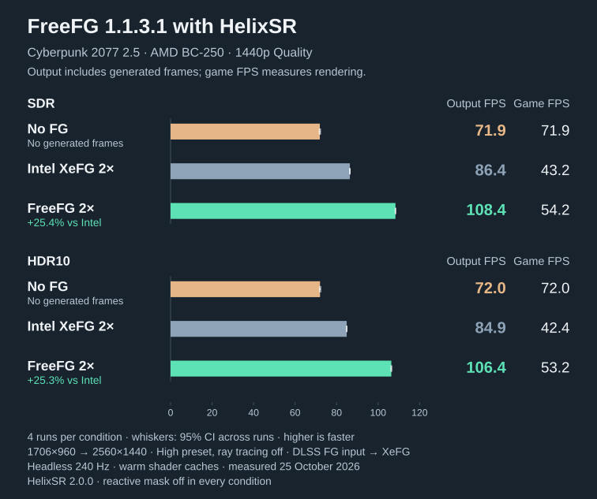

# FreeFG

FreeFG speeds up Intel XeSS Frame Generation (XeFG) on the **AMD BC-250** in DirectX 12 games under Proton. It runs
its own shaders inside Intel's unmodified runtime and paces the output for gamescope and VRR. Upscaling is AMD FSR 4
or one of HelixSR's upscalers, through OptiScaler.

The default is **2×**: one generated frame per rendered frame. Generated frames make motion smoother; they do not
raise the game's simulation rate. 3× and 4× need the separate MFG Unlocker.

Cyberpunk 2.5 on one BC-250, FreeFG 1.1.3.1, HelixSR Quality at 1440p, four headless runs per condition.
[Methods and data](MEASUREMENTS.md#cyberpunk-25-with-helixsr).

## Requirements

- AMD BC-250 with x86-64 Linux (glibc 2.34 or newer), Mesa RADV, Proton and gamescope.
  [Other GPUs are experimental](TROUBLESHOOTING.md#other-gpus).
- A 64-bit DirectX 12 game in Steam, Heroic or Lutris ([other launchers](INSTALLATION.md#other-launchers)), in a
  folder whose path is ASCII only.
- Python 3.11+ and `bsdtar`. Setup's window needs PyGObject, GTK 4 and libadwaita 1.5+; without them Setup uses
  Zenity dialogs.
- Internet access for the first installation's [downloads](PRIVACY.md).

**System check** in Setup, or `python3 install.py doctor`, reports what is missing, including the kernel fix that a
driver with a dedicated compute queue needs. A game with anti-cheat is refused unless you accept the
[risk for that game](COMPATIBILITY.md#anti-cheat).

## Install

1. Extract the [latest release](https://github.com/daniel-h-0/freefg/releases/latest) and run `Start-freefg.sh` in
   Desktop Mode.
2. Choose **Add a Game** and pick the game or its `.exe`.
3. On the game's page choose **Install…**. Keep the suggested input and upscaler, or choose others. Close the game
   and its launcher when asked.
4. In the game, turn on the frame-generation input that Setup names.

[Installation](INSTALLATION.md) covers the inputs, the command line and other launchers.
[Compatibility](COMPATIBILITY.md) explains Setup's verdict for a game.

## Update and remove

Extract the new release, then choose **Update…** on a game's page or **Update All Games…** in the menu. **Rollback**
undoes the last update, upscaler switch, recipe refresh or wiki settings. **Restore** puts the game's original files
back. Close the game first, and its launcher when Setup asks.
[Updates and recovery](INSTALLATION.md#updates-and-recovery).

## Configure

On a game's page:

- **Upscaler**: AMD FSR 4 or one of HelixSR's four upscalers. HLX DLSS Model E is the suggested one and is built once
  on your computer. [Upscalers](CONFIGURATION.md#upscalers).
- **Generated-frame size**: generate at a lower resolution to save GPU time.
  [Scaling](CONFIGURATION.md#generated-frame-scaling).
- **Wiki settings**: OptiScaler settings suggested for the game, shown with their source before you apply any.
  [Wiki settings](CONFIGURATION.md#wiki-settings).

[3× and 4×](CONFIGURATION.md#3-and-4-with-mfg-unlocker) need MFG Unlocker, which FreeFG does not ship.
[Troubleshooting](TROUBLESHOOTING.md) lists the logs and common problems.

## Limits

- Tested on one BC-250 under Proton. Other GPUs and Flatpak launchers are untested.
- By default, generated frames differ slightly from Intel's. `BC250_XEFG_EXACT=1` turns that off; the output then
  matched Intel's in every test. Scaling also changes the generated image.
  [Output differences](ARCHITECTURE.md#fp16-forms-approximate-output-by-default).
- Image quality at 3× and 4× and end-to-end latency have not been measured.
- Only the first XeFG context in a game is accelerated. If Intel's runtime does something FreeFG does not recognise,
  FreeFG steps aside or the game ends.
- Pacing evens out presentation. It cannot hide stalls in the game.

## Documents

- [Installation](INSTALLATION.md) · [Configuration](CONFIGURATION.md) · [Compatibility](COMPATIBILITY.md) · [Troubleshooting](TROUBLESHOOTING.md)
- [Measurements](MEASUREMENTS.md) · [Architecture](ARCHITECTURE.md) · [Building](BUILDING.md) · [Changelog](CHANGELOG.md)
- [Privacy](PRIVACY.md) · [Notices and licences](NOTICE.md) · [Security](SECURITY.md) · [Contributing](CONTRIBUTING.md)

FreeFG is independent of Intel, AMD, NVIDIA, OptiScaler and HelixSR. It downloads Intel's runtime unmodified and
replaces part of the GPU work that runtime does: see [notices and terms](NOTICE.md).
